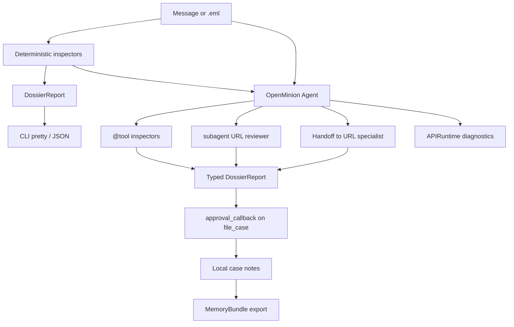

# Dossier

An [OpenMinion](https://github.com/openminion/openminion) `0.1` agent that compiles an **evidence brief** of AI-enabled phishing and social-engineering lures.

It is a clerk, not a judge. It never fetches a destination URL, never sends mail, and never claims that a crime occurred. A human reviewer still decides what to do.

Built for [Cortensor Hackathon #5](https://dorahacks.io/hackathon/2418).

## What it does

Give Dossier a `.eml` file, a pasted message, or stdin. It extracts URLs, mailboxes, and crypto addresses, then looks for:

- lookalike, punycode, and IP-literal hosts
- login, wallet, seed, and redirect-shaped paths and query strings
- urgency, secrecy, gift-card, wire, and seed-phrase language
- claims of an AI-cloned voice or a leaked “as an AI model” persona
- From / Reply-To / display-name mismatches

The result is a scored `DossierReport` with evidence quotes, a calm recommendation, and a disclaimer. Optionally, a reviewer can file a local case note (approval-gated when an OpenMinion agent is used) and export those notes as an OpenMinion `MemoryBundle`.

The samples under `fixtures/samples/` are **fictional lures**, written for tests and the demo.

## How it uses OpenMinion



The deterministic path is always available and is what CI runs. `--agent` wraps the same tools in the released OpenMinion `0.1.22` SDK: `Agent`, `@tool`, `forced_tools`, `output_type=DossierReport`, a durable `session_id`, a bounded `subagent`, a peer `Handoff`, `approval_callback` for `file_case`, `MemoryBundle`, and `APIRuntime` diagnostics. Provider failures, turn timeouts, and schema validation errors fall back to the deterministic brief instead of inventing a result.

OpenMinion state is kept under the project-local `.om-home/` directory (`OPENMINION_HOME` / `OPENMINION_DATA_ROOT`). Scripts refuse to use `/home/box/.local/share` or `/home/box/secure`.

## Quick start

Python 3.11+ and the pinned SDK:

```bash
python3 -m venv .venv
source .venv/bin/activate
python -m pip install -U pip
python -m pip install -e ".[dev]"
make test
python -m dossier inspect fixtures/samples/payroll_lure.eml
python -m dossier inspect --format json fixtures/samples/wallet_seed_lure.txt
```

A short walkthrough video and still frames are in [`demo/`](demo/).

## A real model-backed run

The hackathon asks for a short demo of a **real model** using the SDK. Portal access is optional and is not required for the core score.

1. **Local and free:** install [Ollama](https://ollama.com/download), pull a tool-capable model (`ollama pull llama3.1`), then run `./scripts/setup-ollama.sh` and `python -m dossier inspect --agent fixtures/samples/payroll_lure.eml`.
2. **Cortensor Portal (optional):** if you have a `CORTENSOR_API_KEY`, put it in a gitignored `.env` and run `./scripts/setup-portal.sh`. Then `export DOSSIER_AGENT_ID=cortensor-portal`.
3. **Wiring only:** `./scripts/setup-echo.sh` writes an echo provider config. Echo does not call a model and cannot prove tool use; it is for `dossier doctor` and setup checks.

## Repository layout

```
src/dossier/           Agent, tools, inspectors, CLI
tests/                 Pytest coverage of inspectors, tools, CLI, fallbacks
fixtures/samples/      Fictional lures and a benign control
scripts/               Project-local OpenMinion setup
docs/                  Building blocks tested, and what we learned
demo/                  Walkthrough, frames, and a short video
SUBMISSION.md          Draft DoraHacks BUIDL and community-projects PR text
```

## Commands

| Command | Purpose |
| --- | --- |
| `dossier inspect FILE` | Deterministic evidence brief |
| `dossier inspect --agent FILE` | Same brief, wrapped in an OpenMinion turn |
| `dossier inspect --save-case FILE` | File a local case note from the brief |
| `dossier cases` / `dossier cases --bundle` | List notes, or export a `MemoryBundle` |
| `dossier doctor` | Dump `APIRuntime` posture, capabilities, and tool inventory |

## Documentation for judges

- [Building Blocks Tested](docs/BUILDING_BLOCKS_TESTED.md)
- [What We Learned](docs/WHAT_WE_LEARNED.md)
- [Demo walkthrough](demo/walkthrough.md)

## CI

A GitHub Actions workflow lives at `.github/workflows/ci.yml` in this working tree and runs `pytest`. It is gitignored on purpose: the token used to push this repository does not have the `workflow` scope, so the file is kept local only.

## License

MIT. See [LICENSE](LICENSE).
